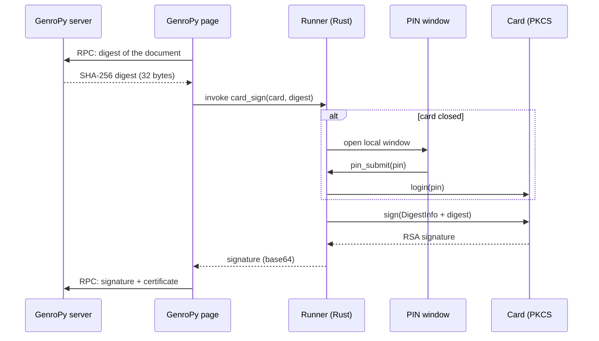

<!-- generated from genropy-runner.xml by xmldocs: do not edit, edit the XML -->

## GenroPy Runner: a desktop window with card signing
*Instruction booklet · booklet/genropy-runner · 2026-11-04*

### Purpose

How to build, configure and use GenroPy Runner: a Tauri 2 desktop app that loads one GenroPy instance in a window without address bar or tabs, and lets the GenroPy page sign with a smart card through PKCS#11.

The project lives in `~/Sviluppo/tauri`. The signing logic is a Rust port of `firmatore_mac/tessere.py` from icond, branch `firma-digitale-protocolli`.


*Signing from the GenroPy page*

### Requirements

- Rust stable (verified with 1.91) and the Tauri CLI 2: `cargo install tauri-cli --version "^2" --locked`.
- macOS: Xcode or its command line tools. Windows: WebView2, preinstalled on Windows 10 and 11.
- For signing: the bit4id PKCS#11 library on the machine. On Windows it comes with Firma4NG of InfoCamere, at 32 bit only.
- Node is not needed: the local pages are plain HTML and JavaScript, with no bundler.

#### 1. Know the project layout

*Files*

| File | Role |
|---|---|
| `src-tauri/src/lib.rs` | Windows, menu, URL resolution, config, PIN request, all Tauri commands. |
| `src-tauri/src/card.rs` | Cards through PKCS#11: read, PIN login, sign, close. |
| `src-tauri/build.rs` | Declares the app commands, so each gets an `allow-<command>` permission. |
| `src-tauri/capabilities/default.json` | Setup window: `get_url`, `save_url`. |
| `src-tauri/capabilities/pin.json` | PIN window: `pin_request`, `pin_submit`, `pin_cancel`. |
| `src-tauri/tauri.conf.json` | Product name, identifier `it.softwell.genropy.runner`, bundle, CSP of the local pages. |
| `setup/` | Local pages: `index.html` (instance URL) and `pin.html` (card PIN). |
| `src-tauri/app-icon.svg` | Source of the icons; `cargo tauri icon app-icon.svg` writes `icons/`. |

#### 2. Build and run in development

```bash
cd ~/Sviluppo/tauri/src-tauri
cargo build
./target/debug/genropy-runner --url https://example.com/app
```

`cargo tauri dev` works as well; arguments for the app go after `-- --`.

#### 3. Set the instance URL

At startup the URL is taken from the first source that has one:

1. `--url <address>` on the command line, for that launch only.
2. `url` in `config.json`, in the app config directory: `~/Library/Application Support/it.softwell.genropy.runner/` on macOS, `%APPDATA%\it.softwell.genropy.runner\` on Windows.
3. Neither: the setup window asks for the URL and saves it in `config.json`.

The menu **Instance → Change URL…** (`Cmd/Ctrl+Shift+U`) reopens the setup window. **Instance → Reload** (`Cmd/Ctrl+R`) reloads the page. Only `http` and `https` URLs are accepted.

`config.json`
```json
{
  "url": "https://example.com/app",
  "pkcs11_library": "/Library/bit4id/pkcs11/libbit4xpki.dylib",
  "session_minutes": 240
}
```

`pkcs11_library` and `session_minutes` are optional. Without `pkcs11_library` the runner looks for the bit4id library in its default locations.

#### 4. Sign from the GenroPy page

The page in the main window calls three commands through `window.__TAURI__.core.invoke`. Outside the runner `window.__TAURI__` does not exist: the page can test it to show or hide the signing controls.

**Example — Calls from the page**

```javascript
const { invoke } = window.__TAURI__.core;

// Cards in the readers, no PIN needed.
// [{fingerprint, holder, serial, valid_until, certificate, open}]
const cards = await invoke('card_list');

// digestBase64: base64 of the 32-byte SHA-256 prepared by the server.
// Returns the base64 RSA PKCS#1 v1.5 signature of its DigestInfo.
const signature = await invoke('card_sign', {card: cards[0].fingerprint, digest: digestBase64});

await invoke('card_close', {card: cards[0].fingerprint});
```

- A card is identified by the sha256 of its signing certificate (keyUsage nonRepudiation), never by the reader.
- `certificate` is the DER certificate in base64: the server needs it to build the PAdES or CAdES signature.
- If the card is closed, `card_sign` opens a local PIN window and waits. The PIN is typed there and never reaches the page.
- The PIN window does not try the PIN when the card signals its last attempt or a locked PIN, nor when the PIN length is outside the card limits.
- After a right PIN the card stays open for `session_minutes`: later signatures need no PIN.
- Closing the PIN window or pressing Cancel makes `card_sign` fail with `PIN cancelled`.

The server side prepares the digest and assembles the signed file: PDF and pyHanko stay on the server. In icond the RPCs for this flow from the page do not exist yet.

#### 5. Build the app for distribution

```bash
cd ~/Sviluppo/tauri/src-tauri
cargo tauri build
```

*Output on macOS (Apple Silicon)*

| File | Size |
|---|---|
| `target/release/bundle/macos/GenroPy Runner.app` | 11.15 MiB |
| `target/release/bundle/dmg/GenroPy Runner_0.1.0_aarch64.dmg` | 3.82 MiB |

The `.app` starts with a double click. Mac Intel needs a universal build:

```bash
rustup target add x86_64-apple-darwin
cargo tauri build --target universal-apple-darwin
```

Windows needs a 32-bit build, because the bit4id DLL of Firma4NG is 32-bit only and a 64-bit process cannot load it. It must be built on Windows:

```bash
rustup target add i686-pc-windows-msvc
cargo tauri build --target i686-pc-windows-msvc
```

#### 6. Check the permissions

Serve a test page on localhost and open it with `--url`. The page calls the commands and prints the result.

```bash
python3 -m http.server 8765 --bind 127.0.0.1   # in the folder with test.html
./target/debug/genropy-runner --url http://localhost:8765/test.html
```

- From the configured origin, `card_list` and `card_sign` reach the Rust code. Without the library they answer `PKCS#11 library not found`.
- From the same page, `get_url` and `pin_submit` are refused with `not allowed on window "main"`.
- After navigating to another origin (`127.0.0.1` instead of `localhost`), `card_list` and `card_sign` are refused too.

### Rules

- **must** — Build the Windows app for `i686-pc-windows-msvc`. *(The bit4id DLL of Firma4NG is 32-bit only.)*
- **must-not** — Ask the PIN from the GenroPy page. The PIN window of the runner is the only place where it is typed. *(A remote page could read it.)*
- **must-not** — Grant `card_*` through a static capability with a wildcard origin. The runner grants them at startup to the origin of the configured URL only. *(Any page loaded in the window would get them.)*
- **must** — Identify a card by its certificate fingerprint, not by the reader. *(tessere.py, test of 2026-11-02: reader order changes between launches.)*

### Current limits

- Signing with a real card is not tested: the build machine has no bit4id library. · `src-tauri/src/card.rs`
- The Windows 32-bit build and the universal macOS build are not done yet.
- The app is signed ad hoc, with no Team ID: on another Mac Gatekeeper blocks it until it is notarized.
- Not ported from icond: reload of the library after the Mac sleeps, detection of readers plugged in after launch. · `src-tauri/src/card.rs`
- A granted origin keeps the card commands until the app exits, also after Change URL. · `src-tauri/src/lib.rs:94`
- Downloads and popups (`window.open`) from the GenroPy page are not tested.
- While a card is open, the page can ask signatures without a new PIN, as with the icond agent. There is no confirmation per signature.

### Verified facts

- `RUN` `src-tauri/src/lib.rs:82` · 2026-11-03 — With `--url https://example.com` the window opens on that page, without address bar, with the host as title and the Instance menu.
- `RUN` `src-tauri/src/lib.rs:57` · 2026-11-03 — Without `--url` and without `config.json` the setup window opens.
- `RUN` `src-tauri/src/lib.rs:94` · 2026-11-03 — The card commands answer the configured origin and are refused to another origin in the same window.
- `RUN` `src-tauri/capabilities/default.json` · 2026-11-03 — The GenroPy page cannot call `get_url` nor `pin_submit`.
- `READ` `src-tauri/src/card.rs:26` · 2026-11-03 — The card signs the SHA-256 DigestInfo prefix followed by the 32-byte digest, with mechanism CKM\_RSA\_PKCS, as `tessere.py` does.
- `READ` `src-tauri/src/card.rs:34` · 2026-11-03 — The default macOS library is `/Library/bit4id/pkcs11/libbit4xpki.dylib`; on Windows the UKC, Firma4NG and System32 copies of `bit4xpki.dll`, in that order.
- `RUN` `target/release/bundle` · 2026-11-03 — `cargo tauri build` produces the `.app` and the `.dmg` for arm64; the `.app` starts with `open`.

### Decisions

- **d-flow** `decided` — How does a signing request reach the app?
   1. **Directly from the page**: The page calls `card_sign` and gets the signature at once. Signing needs the runner open on that page.
   2. **Polling like the icond agent**: The app asks icond every 30 seconds with a token. Signing works with the window closed.
   → Choice: **Directly from the page** (GP, 2026-11-03) — One app for window and signing, no polling.
- **d-stack** `decided` — Electron or Tauri?
   1. **Electron**: Always Chromium; bundle around 100 MB.
   2. **Tauri 2**: System webview (WebKit on macOS, WebView2 on Windows); bundle around 11 MB.
   → Choice: **Tauri 2** (GP, 2026-11-03) — Smaller bundle; native code in Rust.
- **d-notarize** `open` — How is the macOS app notarized?
   1. **Apple ID with app-specific password**
   2. **App Store Connect API key**
