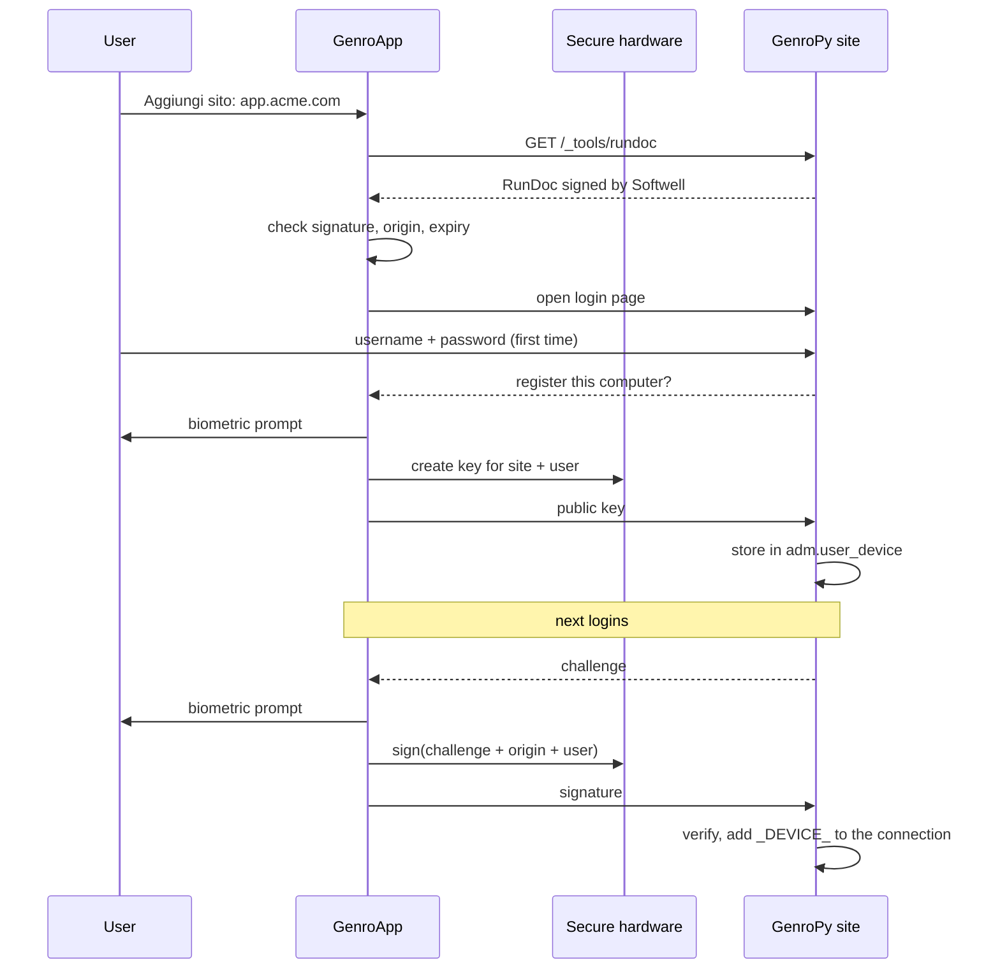

<!-- generated from biometric-login.xml by xmldocs: do not edit, edit the XML -->

## GenroApp sites and biometric login through a device key
*Proposal · proposal/biometric-login · 2026-11-20 · draft*

### Problem

A GenroPy site wants a guarantee that the person using it is the one who passed a biometric reading at login. Today it gets a username and a password, which anyone who knows them can type in any browser.

The goal has four parts:

1. GenroApp proves to the site that a biometric reading happened on a registered computer, at the moment of the login.
2. The administrators of each site decide which users, or all of them, may log in and run given operations only from GenroApp.
3. One GenroApp serves several GenroPy sites, each in its own window, at the same time.
4. Only the sites of customers who pay for the GenroApp service can be used in the app. A customer who has the app but has not paid cannot use it, neither for its own site nor to reach another customer's site.

A user agent string or a header added by GenroApp does not reach these goals: it can be copied into a browser or a script.

### Current state

- `READ` `src-tauri/src/connector.rs (commit fda6173)` · 2026-11-20 — A RunDoc is a JSON envelope `{payload, signature}`. The Ed25519 signature covers the exact payload bytes, payload URL included, and is verified with the Softwell public key embedded in the build.
- `READ` `src-tauri/src/connector.rs:9-23 (commit fda6173)` · 2026-11-20 — The envelope and the payload are parsed with `#[serde(deny_unknown_fields)]`: GenroApp 0.1.0 rejects any field it does not know.
- `READ` `src-tauri/src/documents.rs:26-31 (commit 00a81fe)` · 2026-11-20 — Each opened site gets its own window, identified by the URL origin plus the RunDoc `id`; the Finestre menu lists the open windows.
- `READ` `src-tauri/src/lock.rs:52 (branch feature/touch-id-lock, commit 2cb58bd)` · 2026-11-20 — GenroApp asks Touch ID with `LAContext.evaluatePolicy` and `LAPolicy::DeviceOwnerAuthentication` to unlock its own windows. The check is local: the site cannot verify it, and it also accepts the macOS account password.
- `READ` `projects/gnrcore/packages/adm/resources/login.py:294-337 (genropy develop 448fa4ad24)` · 2026-11-20 — The GenroPy login has a second step: `login_checkAvatar` checks the password, then, when `login_require2fa` is true, keeps `waiting2fa` in the page store and opens the OTP dialog.
- `READ` `gnrpy/gnr/web/gnrwebpage.py:1864-1884 (genropy develop 448fa4ad24)` · 2026-11-20 — `page.userTags` joins the user tags with `rootenv['user_local_tags']`, the tags of the connection.
- `READ` `gnrpy/gnr/web/gnrwebpage.py:1413 (genropy develop 448fa4ad24)` · 2026-11-20 — An RPC declared with `@public_method(tags=…)` is refused on the server when `checkResourcePermission(handler.tags, self.userTags)` fails. Tag rules accept `AND`, `NOT` and `,` (`gnr/app/gnrapp.py:1868`).
- `TEST` `webtools/rundoc.py (genropy branch feature/genroapp-download, commit 2c0e7d8f7c)` · 2026-11-20 — `/_tools/rundoc` serves `site:genroapp/connection.rundoc` as an attachment with MIME `application/vnd.softwell.connection+json`, and answers 404 when the file is missing.

### Proposed solution

#### The RunDoc becomes the licence of the site

The user no longer handles RunDoc files. Softwell signs one RunDoc per paying site, and the site serves it at a fixed address, `/_tools/rundoc`. GenroApp reads it there. The RunDoc is the proof that the site may be used in GenroApp.

- At deploy, the Softwell CI signs the RunDoc of the site (name, URL, icon, expiry) with the Softwell key and writes it to `site:genroapp/connection.rundoc`. The key never reaches the site.
- At every renewal of the service, the CI signs it again with a new expiry.
- A site of a customer who has not paid has no RunDoc, or an expired one.

#### Adding a site

1. GenroApp has no sites and opens the window "Aggiungi sito". The menu also has "Aggiungi sito…" for the next ones. The user types `app.acme.com`.
2. GenroApp calls `https://app.acme.com/_tools/rundoc` and receives the RunDoc.
3. GenroApp checks three things: the Softwell signature, that the URL in the RunDoc has the same origin as the address typed, and that the expiry has not passed. When one check fails it shows "Questo sito non è abilitato a GenroApp" and stops.
4. GenroApp saves the site (name, icon, URL) and opens its window.

- **must** — Every site added in GenroApp belongs to the operating system user who runs the app. Another account of the same computer starts with no sites and no keys. *(the sites, their users and their keys belong to the person logged into the operating system)*

The operating system already enforces the rule: the site list goes in the app configuration folder of the account (`app_config_dir`, where `prefs.rs` of branch `feature/touch-id-lock` already keeps `config.json`), and the keys go in the keychain of the account.

#### Registering the computer

1. The site shows its normal login. The user types username and password, and the OTP when enabled.
2. After the login the site starts the registration. GenroApp asks the biometric reading and creates a key pair in secure hardware, for this site and this user.  
   - User covered by the policy "only from GenroApp": the registration is mandatory, with no way to refuse. When the user cancels the biometric reading, the session is closed.
   - User not covered by the policy: the site asks "Registrare questo computer?". On "no" the session goes on with the password only, without `_DEVICE_`, and the question comes back at the next login.
3. GenroApp sends the public key to the site. The site stores it in a new table `adm.user_device`: user, key type, public key, device name, creation date, last use, revoked flag.
4. GenroApp saves, for the site, the user and the reference to the key. One computer has one user per site.

#### Next logins

1. The user picks the site from the Finestre menu, or GenroApp reopens it at start.
2. GenroApp reads the RunDoc of the site again. When it is expired, the site is disabled in the app with the message "abbonamento scaduto".
3. The site sends a challenge: random bytes, single use, short life, kept in the page store like `waiting2fa`.
4. GenroApp asks the biometric reading. The secure hardware signs the challenge together with the site origin and the user.
5. The site verifies the signature with the keys of `adm.user_device`. A valid signature names the user, and the site adds the tag `_DEVICE_` to the connection, in `rootenv['user_local_tags']`.
6. Depending on the site preference, the user is logged in, or sees the username fixed in a div and types only the password.

*Adding a site and logging in*

#### Policies of the administrators

- **Access only from GenroApp**: an application preference says who must use the app: nobody, everybody, or given groups or tags. A user covered by the rule who logs in without a device signature is refused in `login_checkAvatar`.
- **Operations only from GenroApp**: they are written with the existing tag rules plus `_DEVICE_`, for example `@public_method(tags='admin AND _DEVICE_')` or a menu line with `tags='_DEVICE_'`. The check already runs on the server.
- The administrators keep a way in: users with a given tag may still log in with password, otherwise a lost computer locks everybody out.

#### Platforms

*Secure hardware per platform*

| Platform | Key | Verification | When |
|---|---|---|---|
| macOS | Secure Enclave, P-256 | Touch ID | Now |
| Windows | TPM through Windows Hello (`KeyCredentialManager`), RSA | Hello: face, fingerprint or device PIN | Now |
| Linux | FIDO2 security key | Fingerprint on the key, when the model has a reader | Later |

The protocol towards GenroPy is the same for every platform: registration of a public key, challenge, signature. Adding Linux later adds a key type, not a new login.

#### Paying and non-paying customers

- Customer B, who has not paid, adds its own site: the site has no valid RunDoc, and GenroApp refuses it.
- B copies the RunDoc of customer A onto its own site: the RunDoc carries A's URL under the signature, and the origin check refuses it.
- B adds A's site: the RunDoc is valid, but the first login needs a username and a password of A. Without that login no key is registered, and the biometric reading opens nothing.
- A stops paying: Softwell does not sign a new RunDoc; when the expiry passes, every GenroApp disables A's site.

#### What it guarantees

- A biometric reading on a registered computer happened at the moment of the login.
- The private key cannot be copied to another computer, to a browser or to another account of the same computer.
- On macOS, `biometryCurrentSet` invalidates the key when a finger is added or removed. The user then registers again with password.

- The reading proves a finger enrolled on that computer, not a given person: several people may have a finger enrolled.
- Only the login is protected. After it, the calls use the normal session cookie. GenroApp keeps its cookies in `~/Library/HTTPStorages/it.softwell.genropy.runner.binarycookies`, readable by the macOS user, because the app is not sandboxed: that user can copy the session into a browser. The limit applies to the user himself, not to third parties. A signature on every call is a later step if needed.
- The site cannot prove that the caller is the GenroApp binary: any secret inside the app can be extracted. A user who knows his password can write a script that registers a software key instead of the secure hardware. On macOS the site cannot tell the two apart, because Secure Enclave keys have no attestation outside MDM. Like the cookie, this limit applies to the user himself.

#### Changes by repository

*Work to do*

| Repository | Change |
|---|---|
| GenroApp | Window and menu item "Aggiungi sito"; list of saved sites with user and key reference; check of signature, origin and expiry of the RunDoc read from the site; native commands to create a key for an origin and a user, sign a challenge after the biometric reading, list and delete keys (macOS now, Windows next). |
| GenroPy | Table `adm.user_device`; registration RPC; challenge and verify step in `login_checkAvatar`, next to the OTP step; tag `_DEVICE_` on the connection; preferences for the login mode, for who must use the app and for the password fallback; a page where users see and revoke their devices. |
| GenroPy user settings | The `apps` formlet of branch `feature/genroapp-download` keeps the GenroApp download and gains the device list. The RunDoc download link goes away: the app reads the RunDoc by itself. |
| Softwell CI | Sign the RunDoc of each paying site at deploy and at every renewal, with the expiry, and write it to `site:genroapp/connection.rundoc`. |

### Decisions

- **d-mode** `open` — What does a valid device signature do at login?
   1. **Signature alone**: The signature is the whole login. No password.
   2. **Signature plus password**: The user is fixed from the key and shown in a div; the password is still asked.
   3. **Site preference**: Each site chooses one of the two.
- **d-expiry** `open` — How does a RunDoc expire?
   1. **Signed expiry in the payload**: A field `expires` in a new payload format `v2`. GenroApp 0.1.0 rejects it, so every user must update the app.
   2. **Revocation list**: GenroApp downloads from Softwell a list of revoked sites, signed with the same key. The RunDoc format does not change.
- **d-biometry** `open` — On macOS, must the signature require the finger only, or also accept the Mac password?
   1. **Finger only**: Access control `biometryCurrentSet`. A Mac without Touch ID cannot register.
   2. **Finger or Mac password**: Access control `userPresence`. Works on every Mac, but a known Mac password is enough. Windows Hello always behaves like this, because it accepts the device PIN.
- **d-os-user** `open` — Does the signed login carry the operating system user?
   1. **Hashed, for audit**: A hash of the OS username with a salt per site. The site logs it and compares it with the one stored at registration. It is declared by the app, not proved by the OS.
   2. **No**: The key already belongs to one OS account; the site logs only the device name.
- **d-fido2** `open` — When Linux comes, must FIDO2 keys be limited to models with a fingerprint reader?
   1. **Check the attestation**: At registration the site checks the manufacturer certificate of the key against a list of allowed models.
   2. **Any FIDO2 key**: The flag UV is accepted as is; on a key without reader it means the key PIN, not a finger.

### Consequences

- The user never handles a RunDoc file: adding a site means typing its address.
- Softwell decides which sites may be used in GenroApp, and until when.
- A stolen password is useless without the registered computer and the biometric reading.
- A lost or replaced computer needs a new registration, done with password or by an administrator.
- The commands that use the secure hardware require the app signed with the Softwell team identifier, as it already is for notarization.

### Related documents

- `booklet/genropy-runner` (booklet) — GenroApp: a desktop window with card signing
- `proposal/device-sidecar` (proposal) — Local devices through a Python sidecar
