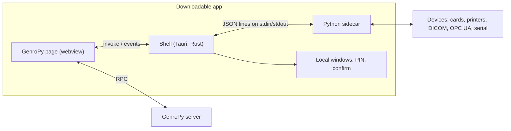

<!-- generated from device-sidecar.xml by xmldocs: do not edit, edit the XML -->

## Local devices through a Python sidecar
*Proposal · proposal/device-sidecar · 2026-11-04 · draft*

### Problem

A GenroPy page in a browser cannot reach the devices of the machine it runs on. The downloadable app exists to give the page that access, and the card reader is only the first device. The next ones are:

- local printers and label printers;
- medical devices, for example ultrasound scanners;
- industry 4.0 equipment: PLCs, sensors, machines;
- other serial, USB or network devices.

The device code must be written in Python, the language of the GenroPy team and of the existing signing agent of icond. Writing each device in Rust inside the Tauri shell does not scale.

### Current state

- **GenroPy Runner** (this repository): Tauri 2 shell with the card logic in Rust, `src-tauri/src/card.rs`. See the booklet (→ booklet/genropy-runner#s-sign).
- **icond signing agent** (`firmatore_mac/`, branch `firma-digitale-protocolli`): Python app in the menu bar or tray, PyKCS11, polls icond every 30 seconds. On Windows it is a 32-bit PyInstaller build, because the bit4id DLL of Firma4NG is 32-bit only.
- **Mobile**: Android and iOS apps are built with Capacitor.

### Proposed solution

The app is split in two processes. A thin shell shows the GenroPy page and guards the access. A Python process, the sidecar, owns every device. The shell never changes when a device is added.


*Processes and data flow*

#### Shell

- Window without browser chrome, instance URL, menu: as in the current runner.
- One generic command for the page: `device_call(module, method, params)`. The shell forwards it to the sidecar and returns the answer.
- Device events (an image received, a PLC value changed) arrive from the sidecar and the shell emits them to the page, which receives them with `listen`.
- Permission per origin, as today: only the origin of the configured URL gets `device_call`. In addition `config.json` lists the modules that origin may use.
- Local windows for what the page must not see or decide alone: card PIN, confirmation of an action. The sidecar asks the shell to open them.
- Tray icon: the app keeps running with the window closed, for the devices that send data by themselves.
- Starts the sidecar at launch, restarts it if it exits, stops it on quit.

#### Sidecar protocol

One JSON object per line. The shell writes requests on the sidecar stdin and reads answers and events on its stdout. The sidecar writes its log on stderr.

```json
{"id": 7, "module": "cards", "method": "sign", "params": {"card": "ab12…", "digest": "base64…"}}
{"id": 7, "result": {"signature": "base64…"}}
{"id": 8, "error": {"code": "pin_cancelled", "message": "PIN cancelled"}}
{"event": "dicom.received", "module": "dicom", "data": {"study": "1.2.840…", "file": "…"}}
{"id": 9, "ui": "pin", "params": {"holder": "Mario Rossi", "min_length": 5, "max_length": 8}}
```

- A request carries `id`; its answer carries the same `id` with `result` or `error`.
- An event carries `event` and no `id`.
- A `ui` line is a request from the sidecar to the shell: open a local window and answer with the same `id`.
- At startup the sidecar sends one line with its modules and their methods. The sidecar itself refuses an unknown module or method with the error code `unknown`.

#### Modules

One Python module per device class, in `sidecar/modules/`. A module exposes its methods with a decorator; the registry builds the startup list from them.

**Example — Shape of a module**

`sidecar/modules/printers.py`
```python
from sidecar.registry import module, method


@module('printers')
class Printers(object):

    @method
    def list(self):
        "Names of the local printers."

    @method
    def print_pdf(self, printer=None, data=None, copies=1):
        "Prints a PDF (base64) on `printer` without a dialog."
```

*Device classes and Python libraries*

| Device | Protocol | Library |
|---|---|---|
| Signing cards | PKCS#11, PC/SC | `PyKCS11`, `pyscard` |
| Local printers | CUPS (macOS), Windows spooler | `pycups` or `lp`, `pywin32` |
| Label printers | raw ZPL/EPL on USB or port 9100 | `socket`, `pyusb` |
| Ultrasound and imaging | DICOM Storage, Modality Worklist | `pynetdicom`, `pydicom` |
| Medical devices with HL7 | HL7 v2 on MLLP | `hl7apy`, `python-hl7` |
| PLCs and machines | OPC UA, Modbus TCP/RTU, Siemens S7 | `asyncua`, `pymodbus`, `python-snap7` |
| Sensors | MQTT | `paho-mqtt` |
| Serial and USB | RS-232/485, HID | `pyserial`, `hidapi` |
| Watched folders | FSEvents (macOS), ReadDirectoryChangesW (Windows) | `watchdog` |
| Photos (macOS) | system picker, PhotoKit | `pyobjc` |
| macOS print panel | PDFKit print operation | `pyobjc` |

Implemented: `system` and `inbox`, described in the booklet (→ booklet/genropy-runner#s-inbox). Next modules, in this order:

1. `printers`: direct print of a PDF with `lp` (CUPS, AirPrint printers included) and the macOS print panel through PDFKit. On Windows `pywin32`.
2. `photos`: the system picker, where the user chooses the photos and the app receives only those. Full library access through PhotoKit needs `NSPhotoLibraryUsageDescription` in the Info.plist of the bundle.
3. `cards`: `tessere.py` of icond with its logic unchanged. The Rust `card.rs` is removed once `cards` works.

#### Packaging

- The sidecar is frozen with PyInstaller and shipped inside the app bundle, next to the shell.
- On Windows the sidecar is a 32-bit build, as the icond agent is today, so it loads the bit4id DLL. The shell stays 64-bit: it never loads the DLL.
- macOS: shell and sidecar are signed with the same Developer ID and notarized together.

#### Why Tauri for the shell

With the Python sidecar the shell is a small fixed layer: window, permissions, forwarding, local windows, tray, updates. The choice is between shells that can host it.

*Shell options*

| Criterion | Tauri 2 | Electron | pywebview | Agent + browser |
|---|---|---|---|---|
| Maturity | 1.0 in June 2022, 2.0 in October 2024 | 1.0 in May 2016; VS Code is built on it | Not evaluated here | No shell: any browser |
| Web engine | System webview: WebKit on macOS, WebView2 (Chromium) on Windows | Chromium bundled, same everywhere | System webview, as Tauri | The user's browser |
| Bundle size | 11.15 MiB measured (.app, arm64) | Bundles Chromium and Node: several times larger (not measured here) | Python runtime plus libraries | Agent only |
| Remote page access control | Built-in per-origin capabilities, tested in the runner | Manual: check the sender frame URL in every IPC handler | Manual: the API is exposed to any loaded page | Manual: local HTTP port and CORS checks |
| Window without browser chrome | Yes | Yes | Yes | No |
| Auto-update | Plugin `updater` | `electron-updater` | None | Agent only |
| Windows 32-bit | Target `i686-pc-windows-msvc` | Last ia32 build: 43.0.0; none from 44.0.0 | Depends on the Python build | Agent only |
| Language of the shell | Rust | JavaScript (Node) | Python | Python |

- **Electron is the more mature option.** It has had releases since 2016, the same Chromium on every system, and its shell would be JavaScript, a language the team already writes.
- **Tauri is proposed** for three reasons. Access control per origin is built in and already tested in the runner; in Electron it is hand-written code in every handler, and an error there exposes the devices to any page. The bundle is several times smaller. The shell already exists and works.
- **The macOS engine is already in use.** Tauri on macOS runs WebKit, the engine of Safari and of the iOS apps, where the GenroPy client is used every day.
- **The 32-bit limit of Electron does not decide.** With the sidecar the shell never loads the bit4id DLL.
- **The choice can be reversed.** The sidecar and its protocol do not depend on the shell. Moving to Electron rewrites only the shell layer: forwarding, origin checks, local windows, tray.
- **pywebview** would give one language, but no access control and no updater: both would have to be written. **Agent + browser** keeps the browser address bar and needs a local HTTP port reachable from the page. **Capacitor for Electron** (`@capacitor-community/electron`) is stopped at 5.0.1 of September 2023, for Capacitor 5, while Capacitor is at 8.6.0.

### Decisions

- **d-shell** `proposed` — Which shell hosts the GenroPy page and the sidecar?
   1. **Tauri 2**: Built-in per-origin access, small bundle, existing runner.
   2. **Electron**: More mature, Chromium everywhere, shell in JavaScript. Access control written by hand.
- **d-protocol** `proposed` — How do shell and sidecar talk?
   1. **JSON lines on stdin/stdout**: No port opened, the sidecar lives and dies with the app.
   2. **Local HTTP or WebSocket**: Easier to debug with curl, but a port on the machine that other processes can reach.
- **d-modules** `proposed` — Which modules may the page use?
   1. **List per origin in config.json**: The shell refuses a call to a module the origin is not granted.
   2. **All modules for the configured origin**
- **d-data-path** `decided` — How does data from a device reach the GenroPy server?
   1. **Through the page**: The sidecar emits an event, the page sends the data with an RPC. Works only with the page open.
   2. **Sidecar to server**: The sidecar posts to the server with a token, as the icond agent does. Works with the window closed.
   → Choice: **Through the page** (GP, 2026-11-04) — The page uploads with the session of the logged-in user. Data that arrives with the app closed waits for the next opening.
- **d-medical** `open` — Does processing images and reports from medical devices make the app medical device software under the MDR? Images and reports are health data under the GDPR in any case. To clarify before distributing the medical modules.
   1. **Not medical device software: data transfer only**
   2. **Medical device software: certification needed**

### Consequences

- The repository gains a `sidecar/` Python package with its own tests and PyInstaller spec.
- `src-tauri/src/card.rs` and the `card_*` commands are replaced by `device_call` and the `cards` module.
- Builds become two per platform (shell and sidecar), joined in one bundle and one installer.
- Modules with listeners (DICOM Storage, HL7, MQTT) open ports on the local network. The icond agent never does; each such port is a configuration choice per installation.
- Mobile stays on Capacitor. A page can detect the platform with `window.Capacitor`, `window.__TAURI__` or neither.

### Related documents

- `booklet/genropy-runner` (booklet) — GenroPy Runner: a desktop window with card signing
