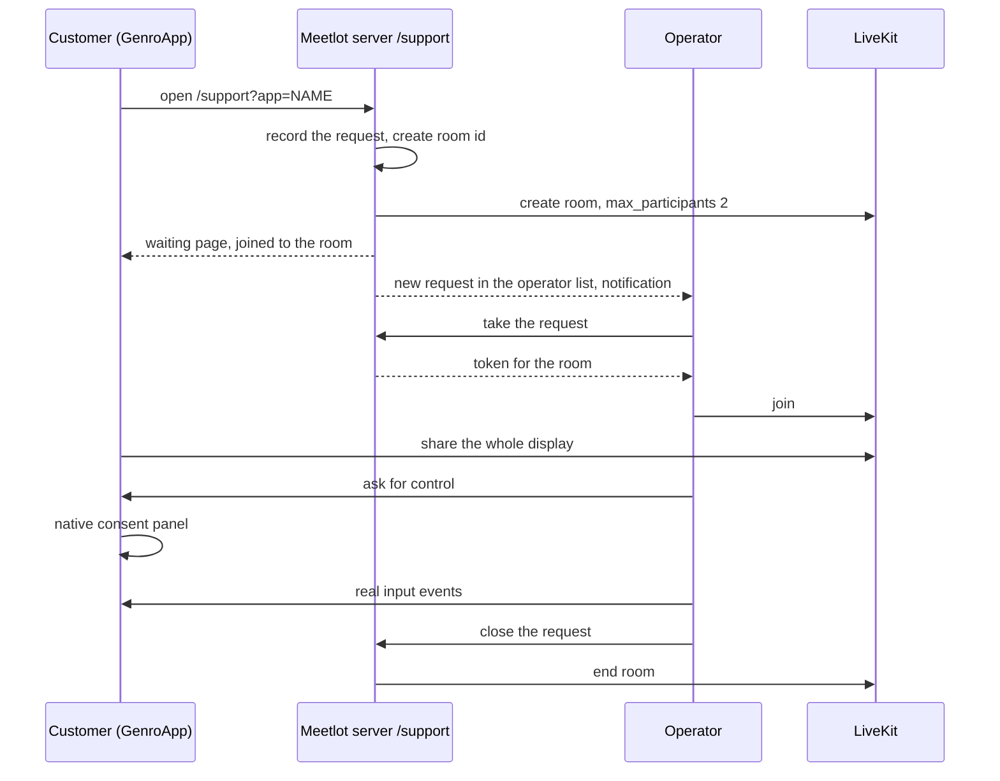

<!-- generated from meetlot-assistance.xml by xmldocs: do not edit, edit the XML -->

## Remote assistance from GenroApp, with code shared with the Meetlot desktop app
*Proposal · proposal/meetlot-assistance · 2026-11-19 · draft*

### Problem

A GenroApp user who needs help has the menu item "Richiedi assistenza…". It opens `https://meetlot.genro.com/support`. That page does not exist on the Meetlot server.

The remote control of a Mac, the sign-in through the system browser and the Developer ID signing exist today only inside the Meetlot desktop app. GenroApp needs the first and the third, and could need the second. Copying them into GenroApp gives two copies to keep aligned.

Signing and notarization are a Softwell process for every app of team `HXS58UUB2N`. Today they are written as Meetlot scripts, with Meetlot names and a personal notarytool profile.

### Current state

#### GenroApp

- `READ` `genroapp: src-tauri/src/lib.rs:170-173` · 2026-11-19 — The menu has a "Meetlot" submenu with "Riunioni di team" and an "Assistenza" submenu with "Richiedi assistenza…". This code is in the working tree, not committed.
- `READ` `genroapp: src-tauri/src/lib.rs:180-186` · 2026-11-19 — "Riunioni di team" opens `https://meetlot.genro.com/call` in a window; "Richiedi assistenza…" opens `https://meetlot.genro.com/support` with `app=<name of the active document>`.
- `READ` `genroapp: src-tauri/src/lib.rs:120-127` · 2026-11-19 — Both windows are plain webviews: no initialization script, no native command granted.
- `READ` `genroapp: src-tauri/tauri.conf.json` · 2026-11-19 — Bundle id `it.softwell.genropy.runner`.
- `READ` `genroapp: src-tauri/src/sidecar.rs:38` · 2026-11-19 — The app runs a Python sidecar named `genropy-sidecar`, a second executable to sign inside the bundle.
- `READ` `genroapp: xmldocs/booklet/genropy-runner.xml:224,262-266` · 2026-11-19 — The app is signed ad hoc. The decision "How is the macOS app notarized?" is open, between an Apple ID with app-specific password and an App Store Connect API key.

#### Meetlot desktop app (kajenn-webrtc/desktop)

- `READ` `kajenn-webrtc: desktop/src-tauri/src/support.rs:28-53,125-198` · 2026-11-19 — Remote control state: one grant per app with lease, window, target process and window id. It ends on stop, on a heartbeat older than 9 seconds, after 30 minutes, on navigation and when the window closes.
- `READ` `kajenn-webrtc: desktop/src-tauri/src/support.rs:39-43` · 2026-11-19 — The native commands accept only a page whose origin is `https://meetlot.genro.com` and whose path is `/call`.
- `READ` `kajenn-webrtc: desktop/src-tauri/src/assistance.m:55-97` · 2026-11-19 — The native consent panel is an `NSAlert` that names the controller and lets the user choose the controllable window.
- `READ` `kajenn-webrtc: desktop/src-tauri/src/support.js:2-3` · 2026-11-19 — The page adapter runs only in the top frame of `https://meetlot.genro.com/call`.
- `READ` `kajenn-webrtc: desktop/src-tauri/src/control_log.rs:13-16` · 2026-11-19 — The control log is written in `~/Library/Logs/Meetlot/controllo.log`.
- `READ` `kajenn-webrtc: desktop/src-tauri/src/browser_login.rs:14-15,30-41` · 2026-11-19 — The system-browser sign-in has the Keycloak realm `softwell`, the client id `meetlot` and the Meetlot callback written as constants.
- `READ` `kajenn-webrtc: desktop/macos/build-developer-id.sh:5,31-32,53-55` · 2026-11-19 — The release script has the team, the bundle id `it.softwell.meetlot`, the sidecar name `meetlot-assist` and the camera and microphone entitlements written in it.
- `READ` `kajenn-webrtc: desktop/macos/developer-id-profile.sh:12-29` · 2026-11-19 — The provisioning-profile script builds an empty Xcode project whose only Meetlot-specific values are the bundle id and the entitlements file.
- `READ` `kajenn-webrtc: xmldocs/booklet/meetlot-macos-release.xml` · 2026-11-19 — Notarization runs by hand with the keychain profile `gp-notary-tool`, an Apple ID with an app-specific password.

The proposal "Full-screen remote control in the Meetlot desktop app" (`kajenn-webrtc/xmldocs/proposal/meetlot-full-screen-control.xml`, not committed yet) replaces the Accessibility actions with real `CGEventPost` events, allows control only on a whole shared display, adds the controller zoom and the local-user pause.

#### Meetlot server (kajenn-webrtc)

- `READ` `kajenn-webrtc: src/kajenn_webrtc/application.py:58-69` · 2026-11-19 — The server has rules for `/admin` and `/call` only. No page, asset or route answers `/support`.
- `READ` `kajenn-webrtc: src/kajenn_webrtc/rooms.py:24-34` · 2026-11-19 — A room is created from a description: room id, administrator and guest invitations valid 7 days. The LiveKit room is created when the administrator joins.
- `READ` `gramlot-webrtc: src/gramlot_webrtc/rooms.py:267-278` · 2026-11-19 — `RtcRooms.create_room` passes only the name and the metadata to `CreateRoomRequest`: no participant limit.
- `READ` `kajenn-webrtc: src/kajenn_webrtc/sourcerer/probe.py:89-95` · 2026-11-19 — The LiveKit API used by the project accepts `max_participants`, `empty_timeout` and `departure_timeout` in `CreateRoomRequest`.

#### Apple tooling

- `RUN` `xcrun notarytool submit --help` · 2026-11-19 — `notarytool` accepts an App Store Connect API key with `--key`, `--key-id` and `--issuer`, also in `store-credentials`.

### Proposed solution

#### 1. Shared code: one Tauri plugin crate

The shared desktop code moves into one Rust crate, a Tauri 2 plugin. The crate has no name yet. Both apps depend on it by git tag.

*What moves into the crate*

| Part | Today in Meetlot | In the crate |
|---|---|---|
| Native input on macOS | `assistance.m` | The `CGEventPost` version of the full-screen control proposal, built by the crate's `build.rs`. |
| Consent panel | `assistance.m:69-96` | Same panel, text "control covers the whole screen", display choice on several displays. |
| Lease, heartbeat, time limit, revoke | `support.rs` | Same rules; the commands `support_start` and `support_event` become plugin commands. |
| Page adapter | `support.js` | Initialization script that the plugin adds to the windows the app names. |
| Control log | `control_log.rs` | Same file format; the directory comes from the app name. |
| Stop control | Menu item in `main.rs` | Global shortcut registered by the plugin. |
| System-browser sign-in | `browser_login.rs` | Same flow; Keycloak endpoint, client id and server callback passed by the app. |

Each app gives the plugin its own configuration:

- the trusted pages: origin and paths (Meetlot: `/call`; GenroApp: `/support`);
- the window labels that receive the page adapter;
- the Keycloak client and callback, only for an app that uses the sign-in.

- **must** — The plugin refuses the native commands from any page outside the trusted pages of the app. *(A page outside the list could otherwise ask for control of the Mac.)*

Each app keeps its own windows, menus, bundle id, Info.plist strings and sidecar.

#### 2. Signing and notarization as a Softwell process

One set of scripts and one booklet serve every macOS app of team `HXS58UUB2N`. They take the app-specific values as input:

- bundle id;
- path of the built `.app`;
- entitlements file;
- nested executables to sign first, each with its identifier (Meetlot: `meetlot-assist`; GenroApp: `genropy-sidecar`).

The scripts do, in order: Developer ID provisioning profile through the empty Xcode project, signing with hardened runtime and timestamp, notarization of the zip, staple, rebuild of the zip, dmg signed and notarized, verification with `spctl` and `stapler validate`.

Notarization uses a team App Store Connect API key, not a personal Apple ID:

- Only the Account Holder can request API access in App Store Connect. Until then the personal profile `gp-notary-tool` stays in use.
- The `.p8` key, its key id and the issuer id are kept in 1Password, vault "Comuni Softwell".
- On each build Mac, `notarytool store-credentials` saves them in the keychain under one profile name agreed by the team.
- The updater private key of each app also lives in that vault, one key per app.

- **must-not** — Write the API key, its ids or an updater private key in a repository. *(It gives access to the notary service of the team.)*

The Meetlot booklet "Release Meetlot for macOS" becomes the Softwell booklet; Meetlot and GenroApp keep only their inputs.

#### 3. The assistance flow

*A request for assistance from GenroApp*

#### What /support does for the customer

1. Shows a form: the customer's name and one line on the problem. `app` from the query prefills the application name.
2. On submit, records the request and creates a dedicated room on the fly: LiveKit room with `max_participants` 2 and a short `empty_timeout`.
3. Joins the customer to the room and shows "waiting for an operator", with the position in the queue.
4. When the operator joins, offers one action: share the whole display.
5. When the operator asks for control, the native consent panel of the plugin opens.
6. Leaving the page, or the end of the request, ends sharing and control.

The page offers no room list, no invitations, no chat history, no recording.

#### What /support does for the operator

1. An operator is a signed-in user with a dedicated tag. Without the tag the page shows the customer view.
2. The operator view lists the open requests live: time, customer name, application, problem line, state (waiting, taken, closed).
3. A new request raises a notification to every operator whose list is open.
4. "Take" assigns the request to the first operator who presses it; the others see it as taken.
5. The operator joins the room and has the remote control of the full-screen control proposal, zoom included.
6. "Close" ends the room and marks the request closed.

- **must** — The support room admits at most 2 participants; LiveKit enforces it with `max_participants`. *(A third person cannot enter an assistance session.)*
- **must** — Control in the support room needs the native consent of the customer at each request, as in Meetlot. *(Control covers the whole screen of the customer.)*

The server side needs a participant limit in `RtcRooms.create_room` (gramlot-webrtc) and the request list in kajenn-webrtc. The minimal client side is the `/support` page plus the plugin in GenroApp; GenroApp does not include the rest of Meetlot.

### Decisions

- **d-crate-home** `open` — Where does the shared crate live?
   1. **Its own repository, both apps depend on a git tag**
   2. **Inside kajenn-webrtc/desktop, GenroApp depends on a git path of that repository**
   3. **Inside genroapp, Meetlot depends on it**
- **d-crate-org** `open` — If it has its own repository, under which GitHub organisation? GenroApp is in `genropy`, Meetlot in `kajenn-org`.
- **d-order** `open` — Does the crate start from today's Accessibility control or after the full-screen control proposal is implemented in Meetlot?
   1. **After: the crate starts from CGEventPost**
   2. **Before: extract now, change inside the crate**
- **d-signing-home** `open` — Where do the Softwell signing scripts and booklet live?
   1. **In the repository of the shared crate**
   2. **In a repository of their own**
- **d-notary-profile** `open` — Which keychain profile name do build Macs use for the team API key?
- **d-customer-identity** `open` — How does /support know who the customer is?
   1. **Name typed in the form, no sign-in**
   2. **Request signed by the GenroPy instance the customer works in**
   3. **Keycloak sign-in through the system browser**
- **d-abuse** `open` — Who may open a request? Without a limit any browser can create rooms on /support.
- **d-operator-tag** `open` — Which identity tag marks a support operator?
- **d-notify** `open` — How is an operator with no open list notified?
   1. **Only operators with the list open**
   2. **Also a notification of the Meetlot desktop app**
   3. **Also an external channel (mail, Telegram)**
- **d-requests-store** `open` — Where are the requests kept? In memory they are lost at an update of the pod.
   1. **In the application instance, part of the update snapshot**
   2. **In a database table, with history**
- **d-team-menu** `open` — Does GenroApp keep the "Riunioni di team" item that opens /call?
   1. **Remove it: full meetings belong to the Meetlot app**
   2. **Keep it as a plain web window, without control**

### Consequences

- Remote control and its consent rules exist once, for both apps.
- A change to the native input reaches GenroApp with a tag update.
- Any Softwell macOS app is signed and notarized with the same scripts and the team key.
- Notarization no longer depends on one person's Apple ID once the team API key exists.
- gramlot-webrtc gains a participant limit; kajenn-webrtc gains the /support page and the request list.
- GenroApp needs Accessibility and Screen Recording permissions on the customer's Mac, asked at the first assistance.
- Windows and Linux need their own native input code; this proposal covers macOS.

### Related documents

- `proposal/device-sidecar` (proposal) — Local devices through a Python sidecar
- `booklet/genropy-runner` (booklet) — GenroApp: a desktop window with card signing
