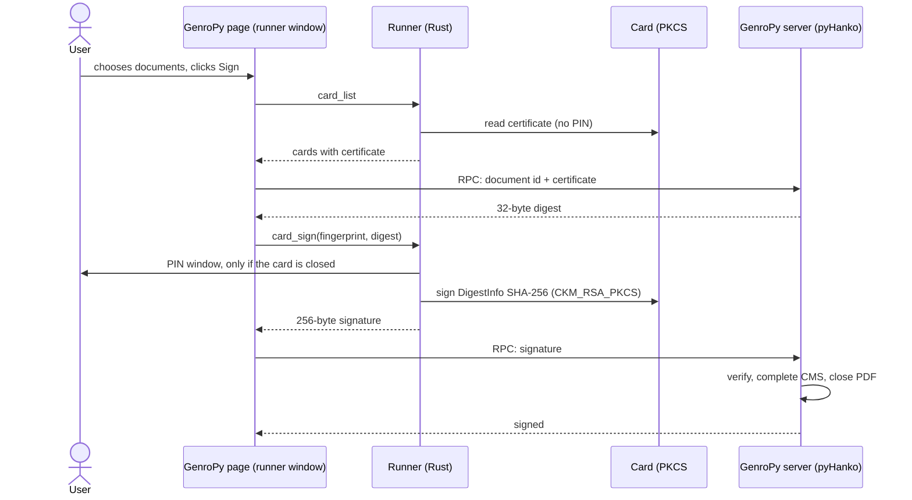

<!-- generated from signing-flow.xml by xmldocs: do not edit, edit the XML -->

## Signing server PDFs with the GenroPy Runner
*Proposal · proposal/signing-flow · 2026-11-04 · draft*

### Problem

A GenroPy application produces PDFs on the server. A user must sign them with a qualified signature, using a smart card or a USB key on the user's own Mac or PC.

- A page in a normal browser cannot reach the card: no web API gives access to the keys of a smart card.
- The private key never leaves the card, so the signature is computed on the user's machine.
- The PDF is built and kept on the server, and must stay there.

### Current state

icond signs its documents in two steps, with an agent on an office Mac (`firmatore_mac/`, branch `firma-digitale-protocolli`).

1. In the browser the signer authorizes the document. The server prepares the PDF and marks it as waiting for signature.
2. The agent, a separate Python app in the menu bar, asks the server every 30 seconds for the next document of an open card (`prossimo`), with a Bearer token.
3. The server, with pyHanko, adds the visible stamp and the signature field, computes the CMS signed attributes and returns their SHA-256: 32 bytes. The half-built PDF and its state stay on the server.
4. The card signs the 32 bytes. The agent sends back the 256-byte signature (`consegna`).
5. The server verifies the signature with the public key of the certificate, completes the CMS and closes the PDF incrementally.

Browser and agent never talk to each other: they meet only on the server. The server side is `preparaFirma` and `completaFirma` in `studio/lib/firma_digitale.py`, on `PdfSigner.async_digest_doc_for_signing` and `PdfTBSDocument.async_finish_signing` of pyHanko 0.38.

### Proposed solution

The GenroPy Runner replaces the agent and keeps the server side unchanged. It signs in two modes. Both send the card only 32 bytes and return only the signature; the PDF never leaves the server and the PIN never leaves the Mac.

#### Direct mode: the page runs inside the runner

The page in the runner window calls the card commands itself. Authorization and signature become the same click, and the result is immediate.

*Direct mode*

1. The page calls `card_list`. The runner reads the signing certificate of each card without PIN and returns it with its fingerprint.
2. The page sends the document id and the chosen certificate to the server with an RPC. The server runs `preparaFirma` and returns the digest.
3. The page calls `card_sign` with the fingerprint and the digest. If the card is closed, the runner opens its local PIN window first. The PIN never reaches the page.
4. The page sends the signature to the server with an RPC. The server runs `completaFirma`.

The page can show the PDF before the click, so the user sees what is signed. With several documents the page repeats steps 2 to 4 for each one, and the PIN is asked once.

#### Queue mode: the user works in a browser

The page is open in Safari or another browser, where the card commands do not exist. The runner works as the icond agent does: it signs, in the background, the documents the user has authorized in the browser.

1. The user authorizes the documents in the browser.
2. For each open card the runner asks the server for the next document, with a token of the signing service.
3. The runner signs the digest and delivers the signature. The server closes the PDF.
4. The browser shows the document as signed at its next refresh.

The runner asks only for open cards: with no open card it sends no request. The connection is always opened by the runner, so no port is opened on the user's machine. A WebSocket from the runner can replace the 30-second poll, with the server announcing new documents.

Queue mode does not exist in the runner yet. It needs the token, the two calls and the loop.

#### What each part does

*Parts and responsibilities*

| Part | Does | Does not |
|---|---|---|
| GenroPy server | Builds the PDF, adds stamp and field, computes the digest, verifies the signature, closes the PDF, keeps the state | Touch the card or the PIN |
| GenroPy page | Shows the documents, starts the signature (direct mode), carries digest and signature between server and runner | See the PIN or the PDF bytes being signed |
| Runner | Reads cards, asks the PIN in a local window, keeps the card session, signs 32 bytes, polls the server (queue mode) | Receive or build the PDF |
| Card | Holds the key, signs | Release the key |

#### Cards and libraries

- The runner loads every PKCS#11 library it finds: bit4id (InfoCamere, Aruba, the CNS Bit4id cards with Actalis certificates used by icond), Athena, OpenSC, and the paths in `pkcs11_libraries` of `config.json`.
- A USB key is a card with its reader built in: the runner reads it in the same way, given its library.
- A card is identified by the SHA-256 of its signing certificate, never by the reader.
- On macOS a second route exists: CryptoTokenKit, where the system exposes the card when its vendor installs a token driver. Not implemented.

#### Lessons from icond

*Lessons and state in the runner*

| Lesson | Runner |
|---|---|
| Sign after merging and numbering: rewriting a signed PDF breaks the signature | Server side, unchanged |
| The stamp goes in the page content, not in the appearance of the signature field | Server side, unchanged |
| One PIN, many signatures: the CNS Bit4id cards sign many digests with one login | Done: session of `session_minutes`, default 240 |
| Do not try the PIN when the card signals its last attempt or a locked PIN | Done |
| The bit4id library fixes the readers when it loads: after sleep, or with a reader plugged in later, it no longer sees the cards. Reload it then, only with no open card | Missing: the runner loads the libraries once |
| No timestamp: the server time is the reference | Server side, unchanged |

#### Remote signature

The server side takes 32 bytes and receives a signature: it does not depend on the card. A provider of remote signature in hash mode, with PIN and OTP from a phone app, fits the same server calls without the runner and without a reader. icond tested it in a sandbox.

### Decisions

- **d-mode** `open` — Which modes does the runner implement?
   1. **Direct only**: Every signer uses the page inside the runner. No polling.
   2. **Queue only**: The runner replaces the icond agent; users stay in the browser.
   3. **Both**: Direct when the page runs in the runner, queue for the documents authorized from a browser.
- **d-pin** `open` — When is the PIN asked?
   1. **Once per session**: As today: the card stays open for `session_minutes`. Suits batch signing. The runner signs any digest the page sends while the card is open.
   2. **At every signature**: The PIN window shows the document name sent by the page. Slower for batches.
- **d-reload** `proposed` — How does the runner see cards after sleep or a new reader?
   1. **Reload the libraries as icond does**: On wake and when a reader appears, only with no open card.

### Consequences

- The server needs two RPCs for the page in direct mode, around `preparaFirma` and `completaFirma`. The queue mode reuses the icond calls.
- The icond agent and the runner can coexist during the transition: the server does not know which one signed.
- When the card logic moves to the Python sidecar (device-sidecar (→ proposal/device-sidecar#d-modules)), the page calls `device_call` instead of `card_sign`. The flow does not change.

### Related documents

- `booklet/genropy-runner` (booklet) — GenroPy Runner: a desktop window with card signing
- `proposal/device-sidecar` (proposal) — Local devices through a Python sidecar
